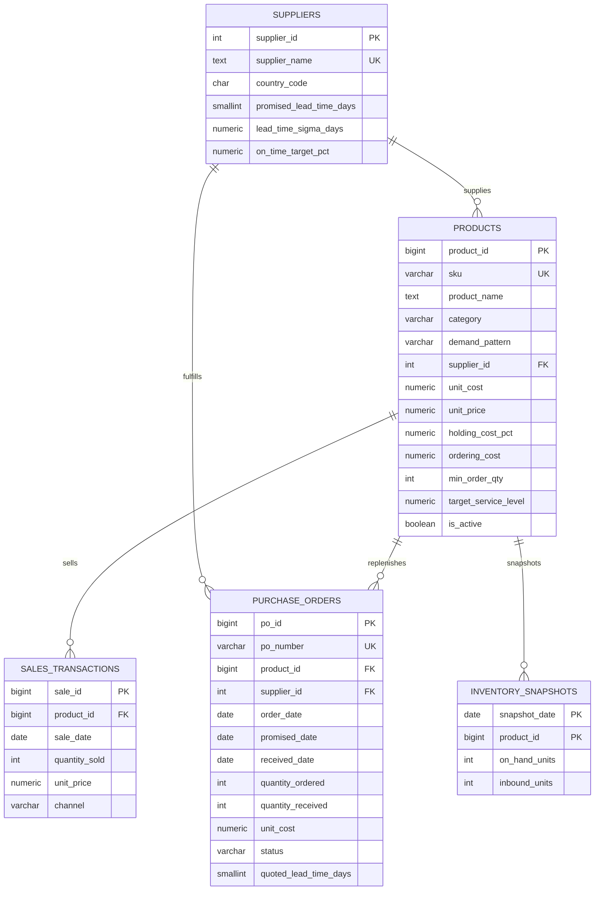
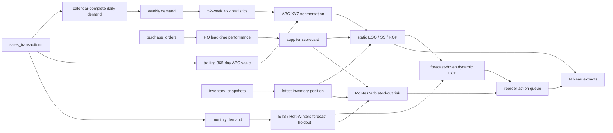

# Data Dictionary

**Project:** Supply Chain Inventory Optimization & Reorder Forecasting  
**Version:** 1.0  
**Analysis date:** 2026-09-30  
**Seed:** 42  
**Currency:** USD unless stated otherwise

This dictionary documents the PostgreSQL core schema, the generated CSV contracts, the derived analytics tables, and the Tableau extracts. It is the reference for anyone rebuilding the database, extending the pipeline, or connecting a BI tool.

---

## 1. Conventions

| Convention | Rule |
|---|---|
| Naming | `snake_case` in the database and CSV files; Tableau displays title-cased labels |
| Dates | ISO 8601 (`YYYY-MM-DD`); timestamps are timezone-aware `TIMESTAMPTZ` in PostgreSQL |
| Currency | USD, stored to two decimals |
| Percentages | Decimal fractions in the data (`0.22` = 22%, `0.95` = 95%, `0.2649` = 26.49%) |
| Units | Physical units of the SKU; not cases, pallets, or weight |
| Nulls | Empty CSV cell = SQL `NULL`; `NaN` for undefined ratios; `NaT` for missing dates |
| Boolean CSV values | `True` / `False`; SQL `BOOLEAN` |
| Grain | Every table states its grain explicitly; never sum repeated supplier attributes across SKUs |
| Reproducibility | All raw data is generated from one seed; derived outputs are deterministic |

> **Important:** `supplier_*` columns in the SKU-level overview are supplier attributes repeated on every SKU row. They are **not additive at SKU grain**. Use `supplier_performance.csv` for supplier-level totals.

---

## 2. Entity relationship diagram



---

## 3. Grain and keys

| Object | Grain | Primary key | Foreign keys |
|---|---|---|---|
| `suppliers` | One row per supplier | `supplier_id` | — |
| `products` | One row per SKU | `product_id` | `supplier_id` |
| `sales_transactions` | One fulfilled sale line | `sale_id` | `product_id` |
| `purchase_orders` | One purchase order | `po_id` | `product_id`, `supplier_id` |
| `inventory_snapshots` | One SKU × snapshot date | (`snapshot_date`, `product_id`) | `product_id` |
| `inventory_overview.csv` | One SKU at the analysis date | `product_id` | — |
| `weekly_demand.csv` | One SKU × week | (`product_id`, `week_start`) | — |
| `monthly_demand_forecast.csv` | One SKU × month × record type | (`product_id`, `month_start`, `record_type`) | — |
| `purchase_order_lead_times.csv` | One PO | `po_id` | — |
| `supplier_performance.csv` | One supplier | `supplier_id` | — |

---

## 4. Core PostgreSQL tables

### 4.1 `suppliers`

Contracted supplier master data. Lead-time statistics used by the policy are stored at supplier level because the synthetic data models one replenishment lane per supplier.

| Field | Type | Null | Key / constraint | Definition |
|---|---|---|---|---|
| `supplier_id` | `INTEGER` | No | PK, identity | Surrogate supplier key |
| `supplier_name` | `TEXT` | No | Unique | Human-readable supplier name |
| `country_code` | `CHAR(2)` | No | — | ISO 3166-1 alpha-2 country of the supplier |
| `promised_lead_time_days` | `SMALLINT` | No | `1..365` | Contractual calendar-day lead time used for planning |
| `lead_time_sigma_days` | `NUMERIC(6,2)` | No | `>= 0` | Planning assumption for lead-time standard deviation |
| `on_time_target_pct` | `NUMERIC(5,4)` | No | `(0, 1]` | Contractual on-time probability target; also used by the simulator |
| `created_at` | `TIMESTAMPTZ` | No | default `CURRENT_TIMESTAMP` | Row load timestamp |

**Business rules**

- A PO snapshots its own `quoted_lead_time_days`; changing the supplier contract later must not rewrite history.
- `lead_time_sigma_days` is a planning fallback. When enough received POs exist, the pipeline uses the observed standard deviation instead.

### 4.2 `products`

SKU master data and inventory-policy parameters.

| Field | Type | Null | Key / constraint | Definition |
|---|---|---|---|---|
| `product_id` | `BIGINT` | No | PK, identity | Surrogate SKU key |
| `sku` | `VARCHAR(32)` | No | Unique | Stable SKU code shown in reports (`SKU-0001` … `SKU-0060`) |
| `product_name` | `TEXT` | No | — | Descriptive product name |
| `category` | `VARCHAR(64)` | No | — | Merchandise category (Electronics, Packaging, Hardware, Consumables, Industrial Components, Safety Equipment) |
| `demand_pattern` | `VARCHAR(16)` | No | `steady`, `seasonal`, `intermittent` | Synthetic demand archetype; used to select forecast candidates |
| `supplier_id` | `INTEGER` | No | FK → `suppliers` | Primary replenishment supplier |
| `unit_cost` | `NUMERIC(12,2)` | No | `> 0` | Standard cost per unit; used for inventory value, ACV, and holding cost |
| `unit_price` | `NUMERIC(12,2)` | No | `>= unit_cost` | List selling price per unit; used for lost-revenue exposure |
| `holding_cost_pct` | `NUMERIC(5,4)` | No | `(0, 1]` | Annual carrying rate applied to unit cost (`0.22` = 22%/year) |
| `ordering_cost` | `NUMERIC(12,2)` | No | `> 0` | Fixed administrative/transport cost per replenishment order (`S` in EOQ) |
| `min_order_qty` | `INTEGER` | No | `> 0` | Supplier minimum order quantity |
| `target_service_level` | `NUMERIC(4,3)` | No | `(0, 1)` | Desired cycle service level used to choose the safety-stock Z value |
| `is_active` | `BOOLEAN` | No | default `TRUE` | Active SKU flag; inactive SKUs are excluded from demand and policy |
| `created_at` | `TIMESTAMPTZ` | No | default `CURRENT_TIMESTAMP` | Row load timestamp |

**Business rules**

- Current on-hand stock is **not** stored here. The latest `inventory_snapshots` row is the source of truth.
- `holding_cost_pct` and `ordering_cost` are SKU-level assumptions. In production they would come from finance and procurement contracts.
- `target_service_level` chooses the static target columns; the dynamic layer also computes 90/95/99 variants for comparison.

### 4.3 `sales_transactions`

Fulfilled demand at line level. Lost sales are deliberately **not** recorded as negative rows.

| Field | Type | Null | Key / constraint | Definition |
|---|---|---|---|---|
| `sale_id` | `BIGINT` | No | PK, identity | Surrogate sale-line key |
| `product_id` | `BIGINT` | No | FK → `products` | SKU sold |
| `sale_date` | `DATE` | No | — | Calendar date of the sale |
| `quantity_sold` | `INTEGER` | No | `> 0` | Units fulfilled on this line |
| `unit_price` | `NUMERIC(12,2)` | No | `>= 0` | Realized selling price after channel adjustment |
| `channel` | `VARCHAR(24)` | No | `Retail`, `Wholesale`, `Online` | Sales channel |

**Business rules**

- A day with no sales has no row. The analytics layer re-creates those zero-demand days on a calendar-complete grid.
- Revenue is derived as `quantity_sold * unit_price`; it is not stored separately.
- Demand is censored by stockouts: if a customer wanted 10 units and only 6 were available, the table records 6. This is disclosed as a limitation.

### 4.4 `purchase_orders`

Replenishment orders. Each PO snapshots its quoted lead time so contract changes do not rewrite history.

| Field | Type | Null | Key / constraint | Definition |
|---|---|---|---|---|
| `po_id` | `BIGINT` | No | PK, identity | Surrogate PO key |
| `po_number` | `VARCHAR(32)` | No | Unique | Human-readable PO identifier (`PO-000001`) |
| `product_id` | `BIGINT` | No | FK → `products` | SKU ordered |
| `supplier_id` | `INTEGER` | No | FK → `suppliers` | Supplying vendor |
| `order_date` | `DATE` | No | — | Date the PO was placed |
| `promised_date` | `DATE` | No | `>= order_date` | Supplier-promised arrival date = order date + quoted lead time |
| `received_date` | `DATE` | Yes | `>= order_date` | Actual warehouse receipt date; `NULL` while open |
| `quantity_ordered` | `INTEGER` | No | `> 0` | Units ordered |
| `quantity_received` | `INTEGER` | No | `0..quantity_ordered` | Units received to date |
| `unit_cost` | `NUMERIC(12,2)` | No | `> 0` | Purchase cost per unit on this PO |
| `status` | `VARCHAR(24)` | No | `OPEN`, `PARTIALLY_RECEIVED`, `RECEIVED`, `CANCELLED` | PO lifecycle state |
| `quoted_lead_time_days` | `SMALLINT` | No | `1..365` | Lead time quoted on this PO at order time |
| `notes` | `TEXT` | Yes | — | Free-text note; open-at-horizon POs are annotated |
| `created_at` | `TIMESTAMPTZ` | No | default `CURRENT_TIMESTAMP` | Row load timestamp |

**Business rules**

- `actual_lead_time_days = received_date - order_date`.
- `variance_days = received_date - promised_date`; negative means early, positive means late.
- Open POs contribute to inventory position and, if promised inside the lead-time horizon, to available inventory for stockout risk.
- `CANCELLED` POs are excluded from performance calculations.

### 4.5 `inventory_snapshots`

Weekly and horizon-end on-hand positions. This is the operational stock source of truth.

| Field | Type | Null | Key / constraint | Definition |
|---|---|---|---|---|
| `snapshot_date` | `DATE` | No | PK part | Monday snapshot date; the analysis date is always included |
| `product_id` | `BIGINT` | No | PK part, FK → `products` | SKU |
| `on_hand_units` | `INTEGER` | No | `>= 0` | Physical units available at the snapshot |
| `inbound_units` | `INTEGER` | No | `>= 0` | Open POs at snapshot time (ordered but not received) |

**Business rules**

- The latest row per SKU is the current stock used by the policy and dashboard.
- `inventory_position_units = on_hand_units + inbound_units`.
- Snapshots are weekly (Monday) plus the final horizon date, giving 105 dates × 60 SKUs = 6,300 rows for seed 42.
- `inbound_units` is a snapshot-time quantity. It is not a PO-level ledger; use `purchase_orders` for PO timing.

---

## 5. Transformation lineage



---

## 6. `inventory_overview.csv` — one row per SKU

This is the primary Tableau fact table at SKU grain. It combines segmentation, static policy, forecast, risk, and action fields. Field names below are the exact CSV headers.

### 6.1 Identity and segmentation

| Field | Type | Definition |
|---|---|---|
| `product_id` | integer | SKU key; joins to demand, PO, and snapshot tables |
| `sku` | string | Stable SKU code |
| `product_name` | string | Descriptive name |
| `category` | string | Merchandise category |
| `demand_pattern` | string | Synthetic archetype: `steady`, `seasonal`, `intermittent` |
| `supplier_id` | integer | Primary supplier key |
| `unit_cost` | decimal | Standard cost per unit |
| `unit_price` | decimal | List selling price per unit |
| `holding_cost_pct` | decimal | Annual carrying rate as a fraction (`0.22` = 22%) |
| `ordering_cost` | decimal | Fixed cost per order |
| `min_order_qty` | integer | Supplier MOQ |
| `target_service_level` | decimal | Target cycle service level (`0.90`, `0.95`, `0.99`) |
| `annual_units` | integer | Fulfilled units in the trailing 365 days |
| `annual_consumption_value` | decimal | `annual_units × unit_cost`; ABC input |
| `weekly_mean_units` | decimal | Mean weekly demand over the latest 52 complete weeks |
| `weekly_std_units` | decimal | Sample standard deviation of weekly demand |
| `weekly_cv` | decimal | `weekly_std_units / weekly_mean_units`; `0` displayed when mean is zero |
| `abc_class` | string | `A`, `B`, or `C` by cumulative annual consumption value |
| `xyz_class` | string | `X`, `Y`, or `Z` by weekly demand CV |
| `abc_xyz_segment` | string | Concatenation such as `AX`, `BZ`, `CY` |

**ABC rule:** sort descending by `annual_consumption_value`; assign A while cumulative value *before* the SKU is below 80%, B below 95%, C otherwise. The boundary SKU completes the class.  
**XYZ rule:** X if `weekly_cv <= 0.50`, Y if `<= 1.00`, Z otherwise. Zero-mean SKUs are Z.

### 6.2 Supplier and lead-time context

| Field | Type | Definition |
|---|---|---|
| `supplier_name` | string | Supplier display name |
| `promised_lead_time_days` | integer | Contractual lead time |
| `lead_time_sigma_days` | decimal | Contractual planning standard deviation |
| `avg_actual_lead_time_days` | decimal | Mean actual lead time across received POs |
| `planning_lead_time_std_days` | decimal | Observed lead-time standard deviation, with contractual fallback |
| `received_po_count` | integer | Received POs used in the supplier statistics |
| `on_time_rate` | decimal | Share of received POs with `received_date <= promised_date` |
| `avg_variance_days` | decimal | Mean `actual - promised`; negative means early on average |
| `supplier_open_inbound_units` | integer | **Supplier-level** open inbound units, repeated on each SKU row; not additive across SKUs |
| `supplier_overdue_inbound_units` | integer | **Supplier-level** open units past promised date, repeated; not additive across SKUs |
| `product_overdue_inbound_units` | integer | Product-level open units past promised date; additive across SKUs |
| `supplier_total_lead_time_exposure_value` | decimal | **Supplier-level** total exposure value, repeated; not additive across SKUs |
| `supplier_total_lead_time_exposure_units` | decimal | **Supplier-level** total exposure units, repeated; not additive across SKUs |
| `supplier_on_time_rate` | decimal | Supplier-level on-time rate, repeated; not additive across SKUs |

> For supplier ranking, use `supplier_performance.csv`, which has one row per supplier. Summing repeated supplier fields in the SKU table inflates totals.

### 6.3 Current inventory and holding cost

| Field | Type | Definition |
|---|---|---|
| `current_stock_units` | integer | On-hand units from the latest inventory snapshot |
| `inbound_open_units` | integer | All open PO units at the analysis date |
| `inventory_position_units` | integer | `current_stock_units + inbound_open_units` |
| `current_inventory_value` | decimal | `current_stock_units × unit_cost` |
| `avg_inventory_value_52w` | decimal | Mean on-hand value over the latest 52 weekly snapshots |
| `annual_holding_cost_52w_avg` | decimal | `avg_inventory_value_52w × holding_cost_pct`; annualized carrying cost of average inventory |
| `next_po_promised_date` | date | Earliest promised date among open POs; null if none |
| `days_of_supply` | decimal | `current_stock_units / avg_daily_demand`; null when historical demand is zero |
| `days_of_supply_forecast` | decimal | `current_stock_units / forecast_daily_demand_30d`; null when forecast demand is zero |

**Why holding cost uses average inventory:** annual carrying cost is incurred on inventory held through the year, not on the ending snapshot. Using current stock would understate or overstate the run-rate depending on the as-of date.

### 6.4 Static EOQ, safety stock, and ROP

| Field | Type | Definition |
|---|---|---|
| `avg_daily_demand` | decimal | Mean daily fulfilled demand over the trailing 365 days, including zero days |
| `daily_demand_std` | decimal | Sample standard deviation of daily demand over the same window |
| `days_observed` | integer | Number of calendar days in the demand window |
| `annual_holding_cost_per_unit` | decimal | `unit_cost × holding_cost_pct` (`H` in EOQ) |
| `eoq_units` | decimal | `sqrt(2 × annual_units × ordering_cost / H)` |
| `recommended_order_qty` | integer | `max(ceil(eoq_units), min_order_qty)` |
| `safety_stock_target_units` | decimal | Safety stock at the SKU's target service level |
| `rop_target_units` | decimal | `avg_daily_demand × avg_actual_lead_time_days + safety_stock_target_units` |
| `target_z` | decimal | Normal quantile for the target service level |
| `safety_stock_constant_lead_target_units` | decimal | Safety stock if lead time were fixed at the promised value |
| `lead_time_safety_stock_penalty_units` | decimal | `max(target safety stock − constant-lead safety stock, 0)` |
| `lead_time_cycle_stock_penalty_units` | decimal | `max((actual mean lead time − promised lead time) × avg daily demand, 0)` |
| `lead_time_exposure_units` | decimal | Sum of the two lead-time penalties |
| `lead_time_exposure_value` | decimal | `lead_time_exposure_units × unit_cost`; SKU-level and additive |
| `eoq_annual_cycle_holding_cost` | decimal | `(eoq_units / 2) × annual_holding_cost_per_unit` |
| `target_safety_stock_holding_cost` | decimal | `safety_stock_target_units × annual_holding_cost_per_unit` |
| `z_90`, `z_95`, `z_99` | decimal | 1.2816, 1.6449, 2.3263 |
| `safety_stock_90_units`, `safety_stock_95_units`, `safety_stock_99_units` | decimal | Safety stock at each service level |
| `rop_90_units`, `rop_95_units`, `rop_99_units` | decimal | ROP at each service level |
| `target_service_level_pct` | integer | 90, 95, or 99 for display |
| `static_gap_to_rop_target_units` | decimal | `inventory_position_units − rop_target_units` |
| `static_reorder_required` | boolean | `inventory_position_units < rop_target_units` using the static policy |

Safety-stock formula:

```text
SS = Z × sqrt(mean_lead_time × daily_demand_std²
              + avg_daily_demand² × lead_time_std²)
ROP = avg_daily_demand × mean_lead_time + SS
```

### 6.5 Forecast-driven policy

| Field | Type | Definition |
|---|---|---|
| `forecast_next_30d_units` | decimal | Expected demand over the next 30 days |
| `forecast_daily_demand_30d` | decimal | Expected daily demand over the next 30 days |
| `forecast_rate_std_daily` | decimal | Residual-based uncertainty in the forecast daily rate |
| `forecast_lead_time_units` | decimal | Expected demand over the SKU's mean lead-time horizon |
| `forecast_lead_time_daily_rate` | decimal | Expected daily rate over the lead-time horizon |
| `forecast_model` | string | Selected ETS / Holt-Winters specification |
| `forecast_wape` | decimal | SKU holdout WAPE; null if the holdout actual was zero |
| `lead_time_horizon_days` | integer | `ceil(avg_actual_lead_time_days)`, minimum 1 |
| `inbound_within_lead_time_units` | integer | Open PO units promised inside the lead-time horizon |
| `available_for_lead_time_units` | decimal | `current_stock_units + inbound_within_lead_time_units` |
| `expected_lead_demand_units` | decimal | `forecast_lead_time_daily_rate × mean lead time` |
| `lead_demand_p95_units` | decimal | 95th percentile of simulated lead-time demand |
| `projected_ending_inventory_units` | decimal | `available_for_lead_time_units − expected_lead_demand_units` |
| `normal_stockout_probability` | decimal | Analytic normal benchmark for `P(D_L > A)` |
| `stockout_probability` | decimal | Monte Carlo probability across 20,000 paths |
| `risk_tier` | string | `Low`, `Watch`, `High`, `Critical` |
| `risk_rank` | integer | 1 = Low, 2 = Watch, 3 = High, 4 = Critical |
| `stockout_risk_flag` | boolean | `stockout_probability >= 0.25` (High/Critical) |
| `watchlist_flag` | boolean | `stockout_probability >= 0.10` (Watch or worse) |
| `projected_lost_sales_units` | decimal | `max(expected_lead_demand_units − available_for_lead_time_units, 0)` |
| `projected_lost_revenue_value` | decimal | `projected_lost_sales_units × unit_price`; revenue, not profit |
| `simulation_count` | integer | Number of Monte Carlo paths (20,000) |
| `dynamic_safety_stock_90_units` … `dynamic_safety_stock_99_units` | decimal | Forecast-driven safety stock at each service level |
| `dynamic_rop_90_units` … `dynamic_rop_99_units` | decimal | Forecast-driven ROP at each service level |
| `dynamic_safety_stock_target_units` | decimal | Dynamic safety stock at the SKU's target service level |
| `dynamic_rop_target_units` | decimal | Dynamic ROP at the SKU's target service level |
| `gap_to_dynamic_rop_units` | decimal | `inventory_position_units − dynamic_rop_target_units` |
| `reorder_status` | string | Operational state (see below) |
| `reorder_required` | boolean | `gap_to_dynamic_rop_units < 0` or `stockout_probability >= 0.25` |
| `suggested_order_units` | integer | Top-up quantity to ROP + recommended cycle quantity, respecting MOQ; 0 when no action |
| `risk_action` | string | Plain-language action paired with the status |

**Dynamic safety stock:**

```text
SS_dynamic = Z × sqrt(mean_lead_time × daily_demand_std²
                      + forecast_daily_rate² × lead_time_std²)
ROP_dynamic = forecast_daily_rate × mean_lead_time + SS_dynamic
```

**Reorder status precedence**

1. `Stocked Out` — on hand is zero and stockout risk is at least 10%.
2. `Reorder Now` — inventory position is at or below the dynamic ROP.
3. `Expedite` — stockout probability is at least 50% despite an inventory position above ROP.
4. `At Risk` — stockout probability is at least 25% with no immediate ROP breach.
5. `Inbound Pending` — on hand is below ROP but open inbound covers the position.
6. `Watch` — stockout probability is at least 10%.
7. `Healthy` — no exception.

### 6.6 Risk tier thresholds

| Tier | Probability | Dashboard response |
|---|---|---|
| Low | `< 10%` | No exception action |
| Watch | `10% – 25%` | Monitor forecast and supplier |
| High | `25% – 50%` | Review quantity, inbound timing, service level |
| Critical | `>= 50%` | Expedite or reorder immediately; validate supply |

---

## 7. `inventory_policy.csv` — static policy audit

One row per SKU. Contains the same identity, supplier, inventory, EOQ, and static 90/95/99 safety-stock fields as `inventory_overview.csv`, but **no** forecast, Monte Carlo, or reorder-action layer. Use it to audit the policy formulas independently of the forecast.

Key fields are defined in sections 6.1–6.4. It is the cleanest input for a spreadsheet-based recalculation of EOQ or safety stock.

---

## 8. `demand_forecasts.csv` — future forecast rows

| Field | Type | Definition |
|---|---|---|
| `product_id` | integer | SKU key |
| `sku` | string | SKU code |
| `demand_pattern` | string | Synthetic archetype |
| `forecast_month` | date | First day of the forecast month (Oct–Dec 2026 for seed 42) |
| `horizon_step` | integer | 1, 2, or 3 months ahead |
| `forecast_units` | decimal | Point forecast for the month |
| `lower_95_units` | decimal | Lower bound of the approximate 95% interval |
| `upper_95_units` | decimal | Upper bound of the approximate 95% interval |
| `model` | string | Selected model for the SKU |
| `model_aic` | decimal | AIC of the selected model |
| `residual_sigma_monthly` | decimal | In-sample residual RMSE in monthly units |
| `forecast_daily_rate` | decimal | `forecast_units / days_in_month` |
| `forecast_rate_std_daily` | decimal | `residual_sigma_monthly / days_in_month` |

The interval is `forecast ± 1.96 × residual_sigma × sqrt(h)`; it is an approximation, not a full predictive distribution.

---

## 9. `forecast_accuracy.csv` — holdout backtest

| Field | Type | Definition |
|---|---|---|
| `product_id`, `sku`, `demand_pattern` | — | SKU identity |
| `holdout_months` | integer | Number of months held out (3) |
| `final_model` | string | AIC-selected model fit on the full 24-month history; this is the model used for future forecasts |
| `holdout_model` | string | AIC-selected model refit on the first 21 months; this is the model whose errors are reported |
| `actual_holdout_units` | integer | Actual units in the holdout |
| `forecast_holdout_units` | decimal | Forecast units in the holdout |
| `abs_error_units` | decimal | Sum of absolute monthly errors |
| `signed_error_units` | decimal | `forecast_holdout_units − actual_holdout_units` |
| `mae_units` | decimal | Mean absolute monthly error |
| `wape` | decimal | `abs_error_units / actual_holdout_units`; null when actual is zero |
| `bias_pct` | decimal | `signed_error_units / actual_holdout_units`; positive = over-forecast |

Weighted WAPE is `sum(abs_error_units) / sum(actual_holdout_units)`. WAPE is preferred to MAPE because intermittent SKUs have zero actuals in some periods.

`final_model` and `holdout_model` can differ because AIC is re-evaluated on the shorter 21-month training window. The holdout measures the selection-and-forecast procedure at that window length; it is not a backtest of the exact 24-month specification. On seed 42, 14 of the 16 final Holt-Winters SKUs selected simple exponential smoothing on the 21-month holdout refit, which is itself evidence that one annual cycle is a thin seasonality signal.

---

## 10. `supplier_performance.csv` — one row per supplier

| Field | Type | Definition |
|---|---|---|
| `supplier_id`, `supplier_name`, `country_code` | — | Supplier identity |
| `promised_lead_time_days`, `lead_time_sigma_days`, `on_time_target_pct` | — | Contract parameters |
| `received_po_count` | integer | Received POs used |
| `avg_actual_lead_time_days` | decimal | Mean actual lead time |
| `lead_time_std_days` | decimal | Sample standard deviation of actual lead time |
| `median_lead_time_days` | decimal | Median actual lead time |
| `p90_lead_time_days` | decimal | 90th percentile actual lead time; exposes the late tail |
| `avg_variance_days` | decimal | Mean actual minus promised |
| `avg_days_late` | decimal | Mean positive lateness |
| `on_time_rate` | decimal | Share received on or before promise |
| `open_po_count` | integer | Open POs at the analysis date |
| `open_inbound_units` | integer | Open units at the analysis date |
| `overdue_open_po_count` | integer | Open POs past promised date |
| `overdue_inbound_units` | integer | Open units past promised date |
| `planning_lead_time_std_days` | decimal | Observed std if positive, else contract sigma |
| `lead_time_variance_days` | decimal | Mean actual minus promised (same as `avg_variance_days`) |
| `lead_time_exposure_units` | decimal | Sum of SKU-level lead-time exposure units |
| `lead_time_exposure_value` | decimal | Sum of SKU-level exposure value at cost |
| `lead_time_safety_stock_units` | decimal | Safety-stock portion of exposure |
| `annual_consumption_value` | decimal | Sum of ACV for the supplier's SKUs |
| `sku_count` | integer | Number of SKUs sourced |
| `avg_lead_time_variance_pct` | decimal | `lead_time_variance_days / promised_lead_time_days` |

**Exposure formula:**

```text
SS_variable = Z × sqrt(actual_mean_LT × daily_std² + avg_daily² × actual_LT_std²)
SS_promised = Z × sqrt(promised_LT × daily_std²)
safety_stock_penalty = max(SS_variable - SS_promised, 0)
cycle_stock_penalty  = max((actual_mean_LT - promised_LT) × avg_daily, 0)
exposure_units       = safety_stock_penalty + cycle_stock_penalty
exposure_value       = exposure_units × unit_cost
```

The exposure is diagnostic. It does not include supplier price differences, quality, capacity, or freight terms.

---

## 11. `purchase_order_performance.csv` — one row per PO

Contains the core PO fields plus:

| Field | Type | Definition |
|---|---|---|
| `actual_lead_time_days` | integer | `received_date − order_date`; null while open |
| `promised_lead_time_days` | integer | `promised_date − order_date` |
| `variance_days` | integer | `received_date − promised_date`; negative = early |
| `on_time_flag` | float | 1.0 if on time, 0.0 if late, null while open |
| `days_late` | float | `max(variance_days, 0)`; null while open |
| `is_received` | boolean | Received-date flag |
| `is_open` | boolean | Status is `OPEN` or `PARTIALLY_RECEIVED` |
| `open_units` | integer | `quantity_ordered − quantity_received` |
| `is_overdue` | boolean | Open and promised date is before the analysis date |
| `open_overdue_units` | integer | `open_units` when overdue, else 0 |
| `as_of_date` | date | Analysis date used for open/overdue evaluation |
| `sku`, `product_name`, `supplier_name` | string | Descriptive attributes |

The Tableau export `purchase_order_lead_times.csv` drops the technical flags and keeps the analysis-friendly fields.

---

## 12. `inventory_snapshots.csv` — Tableau weekly trend

One row per SKU × snapshot date. It augments the raw snapshot with descriptive and retrospective planning fields.

| Field | Type | Definition |
|---|---|---|
| `snapshot_date` | date | Monday snapshot date (and final analysis date) |
| `product_id`, `sku`, `product_name`, `category` | — | SKU identity |
| `on_hand_units` | integer | Physical units at the snapshot |
| `inbound_units` | integer | Open inbound units at the snapshot |
| `inventory_position_units` | integer | `on_hand_units + inbound_units` |
| `unit_cost` | decimal | Standard cost |
| `inventory_value` | decimal | `on_hand_units × unit_cost` |
| `abc_class`, `xyz_class`, `abc_xyz_segment` | string | Current segmentation attributes |
| `trailing_avg_daily_demand` | decimal | Mean daily demand over the 365 days ending at the snapshot |
| `trailing_daily_demand_std` | decimal | Sample daily demand std over the same window |
| `planning_lead_time_days` | decimal | Mean actual lead time used in the retrospective ROP |
| `planning_lead_time_std_days` | decimal | Planning lead-time std used in the retrospective ROP |
| `target_service_level` | decimal | SKU target service level |
| `target_z` | decimal | Normal quantile for that service level |
| `historical_safety_stock_target_units` | decimal | Safety stock at the snapshot using trailing demand |
| `historical_rop_target_units` | decimal | Retrospective ROP at the snapshot |
| `on_hand_vs_rop_units` | decimal | `on_hand_units − historical_rop_target_units` |
| `snapshot_stock_status` | string | `Stocked Out`, `Reorder Now`, `Inbound Pending`, or `Healthy` at the snapshot |

**Interpretation:** the historical ROP line tells you what the current policy would have required given the demand known at that date. It is not the order the simulator actually placed, and it uses full-window lead-time parameters. The live, forecast-driven actions are in `inventory_overview.csv` and `reorder_alerts.csv`.

---

## 13. Demand tables

### 13.1 `daily_demand.csv`

| Field | Type | Definition |
|---|---|---|
| `product_id` | integer | SKU |
| `demand_date` | date | Calendar date |
| `units_sold` | integer | Fulfilled units; 0 on no-sale days |
| `revenue` | decimal | `units_sold × realized price` |

One row per SKU × calendar day. This is the canonical demand table; use it, not raw sales rows, for volatility and safety stock.

### 13.2 `weekly_demand.csv`

| Field | Type | Definition |
|---|---|---|
| `product_id` | integer | SKU |
| `week_start` | date | Monday |
| `week_end` | date | Sunday |
| `units_sold` | integer | Weekly units, including zero-sale weeks |
| `revenue` | decimal | Weekly revenue |

The Tableau copy adds `sku`, `product_name`, `category`, `abc_class`, `xyz_class`, `abc_xyz_segment`, and `supplier_name`.

### 13.3 `monthly_demand.csv`

| Field | Type | Definition |
|---|---|---|
| `product_id` | integer | SKU |
| `month_start` | date | First day of month |
| `actual_units` | integer | Fulfilled units, including zero months |
| `demand_pattern` | string | Synthetic archetype |

### 13.4 `monthly_demand_forecast.csv` — Tableau long table

| Field | Type | Definition |
|---|---|---|
| `product_id` | integer | SKU |
| `month_start` | date | Month being plotted |
| `record_type` | string | `Actual` or `Forecast` |
| `actual_units` | decimal | Actual units for actual rows; null for forecast rows |
| `forecast_units` | decimal | Forecast for forecast rows; null for actual rows |
| `lower_95_units`, `upper_95_units` | decimal | Forecast interval; null for actual rows |
| `forecast_month` | date | Forecast month for forecast rows; null for actual rows |
| `demand_pattern` | string | Archetype |
| `model` | string | Selected model; null for actual rows |
| `sku`, `product_name`, `category`, `abc_class`, `xyz_class`, `abc_xyz_segment`, `supplier_name` | — | Descriptive attributes |

One row per SKU × month × record type. The long shape lets Tableau draw actual and forecast series on one axis without a dual-axis workaround.

---

## 14. `reorder_alerts.csv` — actionable subset

One row per SKU whose `reorder_status` is one of:

`Stocked Out`, `Reorder Now`, `Expedite`, `At Risk`, or `Watch`.

It has the same columns as `inventory_overview.csv`; it is pre-filtered to reduce dashboard load and keep planner attention on exceptions. The full overview remains the source for "all SKUs" views.

---

## 15. Tableau extract summary

| File | Grain | Primary key | Rows (seed 42) | Use |
|---|---|---|---:|---|
| `inventory_overview.csv` | SKU | `product_id` | 60 | KPI cards, segmentation, current policy, risk |
| `abc_xyz_summary.csv` | ABC × XYZ | (`abc_class`, `xyz_class`) | 9 | Heatmap matrix |
| `weekly_demand.csv` | SKU × week | (`product_id`, `week_start`) | 6,300 | Demand trend |
| `monthly_demand_forecast.csv` | SKU × month × type | (`product_id`, `month_start`, `record_type`) | 1,620 | Actual vs forecast |
| `demand_forecast.csv` | SKU × future month | (`product_id`, `forecast_month`) | 180 | Forecast detail |
| `supplier_performance.csv` | Supplier | `supplier_id` | 12 | Supplier scorecard |
| `purchase_order_lead_times.csv` | PO | `po_id` | 446 | Actual vs promised lead time |
| `inventory_snapshots.csv` | SKU × week | (`product_id`, `snapshot_date`) | 6,300 | On-hand vs retrospective ROP |
| `forecast_accuracy.csv` | SKU | `product_id` | 60 | Forecast quality |
| `reorder_alerts.csv` | Actionable SKU | `product_id` | 5–10 | Planner queue |

`abc_xyz_summary.csv` contains one row for each populated segment. Empty segments are not materialized; a Tableau matrix should use a fixed 3 × 3 axis and show zero/blank for absent combinations.

---

## 16. Null and edge-case semantics

| Situation | Representation | Correct handling |
|---|---|---|
| Open PO has no receipt | `received_date = NULL`, `actual_lead_time_days = NULL`, `variance_days = NULL` | Exclude from lead-time averages; include in open inbound |
| Open PO on-time flag | `on_time_flag = NULL` | Do not treat as late |
| SKU has no open PO | `next_po_promised_date = NULL`, `inbound_open_units = 0` | Show "No inbound" in Tableau |
| SKU has no forecast accuracy | `forecast_wape = NULL` (only if holdout actual is zero) | Display "n/a", not zero |
| Zero historical demand | `days_of_supply = NULL` | Do not divide by zero |
| Zero forecast demand | `days_of_supply_forecast = NULL` | Use "no demand forecast" |
| Zero weekly mean | `weekly_cv = 0` for display, `xyz_class = Z` | Use the class, not the displayed CV, for policy |
| No sales on a day | Row exists with `units_sold = 0` in daily/weekly/monthly tables | Keep zeros; they are signal |
| Supplier with no received POs | Contract values used as fallback | Flag low history in production |
| Missing `notes` | Empty cell / `NULL` | Display blank |

---

## 17. Validation rules

The pipeline and SQL quality checks enforce:

- unique `products.sku` and one row per SKU in `inventory_overview.csv`;
- positive sales quantities and valid references;
- no receipt before order;
- no negative on-hand or inbound units;
- one latest snapshot per SKU and `current_stock_units` equal to it;
- forecast horizon strictly after the analysis date;
- non-negative forecasts and finite dynamic ROPs;
- stockout probabilities in `[0, 1]`;
- inventory position at least on-hand;
- all required Tableau extract columns present;
- no duplicate `_x` / `_y` columns in the monthly long table.

See `sql/03_quality_checks.sql` for the database version and `tests/` for executable checks.

---

## 18. Example queries

### Static policy for one SKU

```sql
SELECT sku,
       on_hand_units,
       inbound_units,
       inventory_position_units,
       rop_at_target_units,
       stock_status
FROM supply_chain.v_reorder_recommendations
WHERE sku = 'SKU-0004';
```

### Supplier scorecard

```sql
SELECT supplier_name,
       on_time_rate,
       avg_actual_lead_time_days,
       avg_promised_lead_time_days,
       avg_variance_days,
       p90_actual_lead_time_days
FROM supply_chain.v_supplier_performance
ORDER BY on_time_rate ASC;
```

### Weekly demand for one SKU

```sql
SELECT week_start, units_sold
FROM supply_chain.v_weekly_demand
WHERE product_id = 4
ORDER BY week_start;
```

The SQL views in `sql/02_views.sql` expose live-database equivalents under the `supply_chain` schema. The forecast and Monte Carlo layers remain Python outputs because they are model artifacts, not deterministic SQL transformations.

---

## 19. Version history

| Version | Date | Change |
|---|---|---|
| 1.0 | 2026-10-25 | Initial documented schema, derived tables, and Tableau extracts |

For formula derivations, assumptions, and model validation, see [`methodology.md`](methodology.md). For the dashboard build, see [`tableau_dashboard_spec.md`](tableau_dashboard_spec.md).
