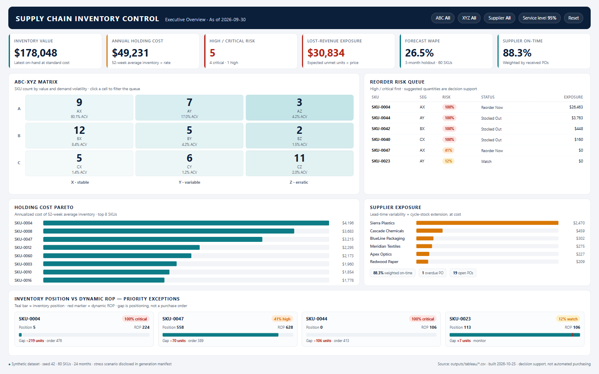

# Tableau Dashboard Specification

**Project:** Supply Chain Inventory Optimization & Reorder Forecasting  
**Workbook:** `supply_chain_inventory_optimization.twbx`  
**Audience:** Supply-chain director, inventory planner, procurement lead  
**Primary question:** Where is working capital tied up, where is service at risk, and what should we do this week?



The preview is a high-fidelity layout mockup built from the seed-42 outputs. It is not a shipped Tableau workbook; it is the visual contract for the build.

---

## 1. Design principles

1. **Exception-first.** The default view answers "what needs attention now?" before "what happened?"
2. **One question per page.** Executive overview, reorder execution, supplier performance, and SKU diagnosis are separate pages.
3. **Value and risk together.** A high stockout probability on a C item is not the same as on an A item. Always pair risk with annual consumption value or inventory value.
4. **No false precision.** Forecast WAPE and Monte Carlo probability are shown with the model caveat, not as certainty.
5. **Drill, don't cram.** The overview stays at SKU/segment grain; PO-level and weekly detail live in drilldown pages.
6. **Synthetic-data disclosure.** Every dashboard footer states that the data is synthetic and the horizon-end stress scenario is deliberate.

---

## 2. Data sources and relationships

### 2.1 Sources

| Tableau data source | File | Grain | Rows | Use |
|---|---|---|---:|---|
| Inventory Overview | `outputs/tableau/inventory_overview.csv` | SKU | 60 | KPI cards, segmentation, current policy, risk, action queue |
| ABC-XYZ Summary | `outputs/tableau/abc_xyz_summary.csv` | ABC × XYZ | 9 | Heatmap matrix |
| Weekly Demand | `outputs/tableau/weekly_demand.csv` | SKU × week | 6,300 | Demand trend, seasonality |
| Monthly Demand Forecast | `outputs/tableau/monthly_demand_forecast.csv` | SKU × month × type | 1,620 | Actual vs forecast with interval |
| Demand Forecast | `outputs/tableau/demand_forecast.csv` | SKU × future month | 180 | Forecast detail table |
| Supplier Performance | `outputs/tableau/supplier_performance.csv` | Supplier | 12 | Supplier scorecard, exposure |
| PO Lead Times | `outputs/tableau/purchase_order_lead_times.csv` | PO | 446 | Actual vs promised dot plot, PO timeline |
| Inventory Snapshots | `outputs/tableau/inventory_snapshots.csv` | SKU × week | 6,300 | On-hand vs retrospective ROP trend |
| Forecast Accuracy | `outputs/tableau/forecast_accuracy.csv` | SKU | 60 | Forecast quality |
| Reorder Alerts | `outputs/tableau/reorder_alerts.csv` | Actionable SKU | 5–10 | Pre-filtered planner queue |

### 2.2 Relationship model

Use **separate data sources per page** and dashboard actions for cross-filtering. Do not physically join all facts into one flat table: weekly demand, monthly forecast, and PO rows have different grains and will fan out SKU-level measures.

If you prefer a single logical data source, use Tableau **relationships**, not joins:

```text
Inventory Overview (1) ──< Weekly Demand (N)        on product_id
Inventory Overview (1) ──< Monthly Demand Forecast (N) on product_id
Inventory Overview (1) ──< Inventory Snapshots (N)   on product_id
Inventory Overview (1) ──< PO Lead Times (N)         on product_id
Supplier Performance (1) ──< PO Lead Times (N)       on supplier_id
```

Keep the SKU-level measures (`Annual Consumption Value`, `Current Inventory Value`, `Annual Holding Cost 52w Avg`) in the Inventory Overview source. When a worksheet uses a many-row source, aggregate at the correct grain or use `COUNTD([Product Id])` rather than `COUNT(*)`.

### 2.3 Field naming

Tableau normalizes CSV headers. Rename these fields once in the data source so the calculations below work verbatim:

| CSV header | Tableau display name |
|---|---|
| `product_id` | `Product ID` |
| `sku` | `SKU` |
| `abc_class` | `ABC Class` |
| `xyz_class` | `XYZ Class` |
| `abc_xyz_segment` | `ABC-XYZ Segment` |
| `current_stock_units` | `Current Stock Units` |
| `inventory_position_units` | `Inventory Position Units` |
| `dynamic_rop_target_units` | `Dynamic ROP Target Units` |
| `stockout_probability` | `Stockout Probability` |
| `annual_holding_cost_52w_avg` | `Annual Holding Cost 52w Avg` |
| `supplier_total_lead_time_exposure_value` | `Supplier Total Lead Time Exposure Value` |
| `historical_rop_target_units` | `Historical ROP Target Units` |

Tableau may render `ROP` as `Rop`. Rename the field to the display name above; otherwise calculated fields will not resolve.

---

## 3. Wireframe

### 3.1 Executive Overview (1440 × 900)

```text
┌──────────────────────────────────────────────────────────────────────────────────────────────┐
│  SUPPLY CHAIN INVENTORY CONTROL          As of 2026-09-30        [ABC ▾] [XYZ ▾] [Supplier ▾] │
│  Executive Overview                                             [Service level: 95% ▾] [Reset] │
├──────────────────────────────────────────────────────────────────────────────────────────────┤
│  $178,048          $49,231           5                  $30,834         26.5%         88.3%   │
│  Inventory value   Annual holding    High/Critical     Lost-revenue    Forecast      Supplier   │
│                    cost              risk SKUs         exposure        WAPE          on-time   │
├───────────────────────────────────────────────────────┬──────────────────────────────────────┤
│  ABC-XYZ MATRIX                                       │  REORDER RISK QUEUE                  │
│                                                       │  ┌────────────────────────────────┐  │
│        X          Y          Z                        │  │ SKU      Seg  Risk  Status  $  │  │
│   A    9          7          3                        │  │ SKU-0004 AX  100%  Reorder ...│  │
│   B   12          5          2                        │  │ SKU-0044 AY  100%  Stocked ...│  │
│   C    5          6         11                        │  │ SKU-0042 BX  100%  Stocked ...│  │
│                                                       │  │ SKU-0040 CX  100%  Stocked ...│  │
│   color = SKU count; tooltip = ACV, inventory, risk    │  │ SKU-0047 AX   41%  Reorder ...│  │
├───────────────────────────────────────────────────────┤  └────────────────────────────────┘  │
│  HOLDING COST PARETO                                  │                                      │
│  SKU-0004 ███████████████████████████████ $4,196      │  SUPPLIER EXPOSURE                   │
│  SKU-0008 ████████████████████████ $3,683             │  Sierra Plastics   ███████ $2,470    │
│  SKU-0047 ███████████████████ $3,215                  │  Cascade Chemicals ██ $459           │
│  SKU-0012 █████████████ $2,295                        │  BlueLine          █ $302            │
│  SKU-0060 ████████████ $2,173                         │  Meridian          █ $275            │
│  cumulative line ──────────────────────────── 72%     │  Redwood Paper     █ $209            │
├───────────────────────────────────────────────────────┴──────────────────────────────────────┤
│  INVENTORY POSITION VS DYNAMIC ROP — TOP 10 EXCEPTIONS                                      │
│  SKU-0004  ██ 5        | ROP 224        gap -219        risk 100%  ● Critical                 │
│  SKU-0047  █████ 558  | ROP 628        gap -70         risk 41%   ● High                     │
│  ...                                                                                         │
├──────────────────────────────────────────────────────────────────────────────────────────────┤
│  Synthetic dataset · seed 42 · stress scenario disclosed · source: outputs/tableau/*.csv     │
└──────────────────────────────────────────────────────────────────────────────────────────────┘
```

### 3.2 Reorder Engine

```text
┌──────────────────────────────────────────────────────────────────────────────────────────────┐
│  REORDER ENGINE                                        [Status ▾] [Risk ▾] [Supplier ▾]     │
├──────────────────────────────────────────────────────────────────────────────────────────────┤
│  Actions 5    Stocked out 3    Reorder now 2    Open POs 19    Overdue 1    Inbound 2,784    │
├───────────────────────────────────────────────────────┬──────────────────────────────────────┤
│  INVENTORY POSITION VS DYNAMIC ROP                    │  RISK VS VALUE                       │
│  horizontal dumbbell / bar per SKU                    │  y = annual consumption value         │
│  color = reorder status; label = gap                  │  x = stockout probability            │
│  reference line at gap = 0                            │  size = current inventory value       │
│                                                       │  color = risk tier                    │
├───────────────────────────────────────────────────────┼──────────────────────────────────────┤
│  REORDER ALERT QUEUE                                  │  SUGGESTED ORDER VALUE               │
│  SKU | Seg | Supplier | On hand | Position | ROP |    │  top 10 bars                          │
│  Gap | Risk | Tier | Status | Order qty | Action      │                                      │
├───────────────────────────────────────────────────────┴──────────────────────────────────────┤
│  Click a SKU to open the drilldown. Suggested quantities are decision support, not POs.      │
└──────────────────────────────────────────────────────────────────────────────────────────────┘
```

### 3.3 Supplier Performance

```text
┌──────────────────────────────────────────────────────────────────────────────────────────────┐
│  SUPPLIER PERFORMANCE                                  [Supplier ▾] [Country ▾]              │
├──────────────────────────────────────────────────────────────────────────────────────────────┤
│  Weighted OTD 88.3%   Avg variance -0.7 d   Overdue POs 1   Exposure $4,451   Open units 2,784│
├───────────────────────────────────────────────────────┬──────────────────────────────────────┤
│  PROMISED VS ACTUAL LEAD TIME                         │  ON-TIME VS EXPOSURE                 │
│  supplier rows; promised dot + actual dot + line      │  x = on-time rate                    │
│  color = late/early; P90 marker                       │  y = exposure value                  │
│                                                       │  size = SKU count                    │
├───────────────────────────────────────────────────────┼──────────────────────────────────────┤
│  LEAD-TIME VARIABILITY                                │  PO-LEVEL DOT PLOT                   │
│  bars = lead-time std; labels = P90                   │  actual vs promised by PO            │
│  color = on-time rate                                 │  color = late / on-time              │
├───────────────────────────────────────────────────────┴──────────────────────────────────────┤
│  SUPPLIER TABLE: promised, actual, std, P90, OTD, variance, open/overdue, exposure, SKUs      │
└──────────────────────────────────────────────────────────────────────────────────────────────┘
```

### 3.4 SKU Drilldown

```text
┌──────────────────────────────────────────────────────────────────────────────────────────────┐
│  SKU-0004 · Precision Signal Cable 104        [Search SKU ▾]        [Back to overview]       │
│  AX · Electronics · Sierra Plastics · target 95% · forecast WAPE 12.4%                       │
├──────────────────────────────────────────────────────────────────────────────────────────────┤
│  On hand 5   Position 5   Dynamic ROP 224   Gap -219   Risk 100%   Days supply 2.5           │
├───────────────────────────────────────────────────────┬──────────────────────────────────────┤
│  DEMAND: ACTUAL VS FORECAST                           │  INVENTORY VS ROP                    │
│  monthly line + 95% band                              │  weekly on-hand + retrospective ROP  │
│  actual solid, forecast dashed                        │  current dynamic ROP reference line  │
├───────────────────────────────────────────────────────┼──────────────────────────────────────┤
│  PO TIMELINE                                          │  POLICY COMPARISON                   │
│  order → promised → received Gantt                    │  static 90/95/99 vs dynamic target   │
│  color = late/on-time/open                            │  EOQ, safety stock, suggested order  │
├───────────────────────────────────────────────────────┴──────────────────────────────────────┤
│  Supplier context: promised 21 d · actual 20.9 d · P90 24 d · OTD 85% · exposure $2,470      │
└──────────────────────────────────────────────────────────────────────────────────────────────┘
```

---

## 4. Page 1 — Executive Overview

### 4.1 Purpose

Give a director a 30-second read on working capital, service risk, and supplier exposure, with a path to action.

### 4.2 Layout

| Zone | Position | Content |
|---|---|---|
| Header | Top 90 px | Title, as-of date, filters, reset |
| KPI band | 90–210 px | Six KPI cards |
| Left column | 210–620 px | ABC-XYZ heatmap (top), holding-cost Pareto (bottom) |
| Right column | 210–620 px | Risk queue (top), supplier exposure (bottom) |
| Exception strip | 620–840 px | Inventory position vs dynamic ROP, top 10 |
| Footer | 840–900 px | Source, seed, synthetic-data disclaimer |

### 4.3 KPI cards

| Card | Measure | Format | Notes |
|---|---|---|---|
| Inventory value | `SUM([Current Inventory Value])` | `$#,##0` | Latest snapshot × standard cost |
| Annual holding cost | `SUM([Annual Holding Cost 52w Avg])` | `$#,##0` | 52-week average inventory × holding rate |
| High/Critical risk | `COUNTD(IF [Stockout Risk Flag] THEN [Product ID] END)` | `#,##0` | Flag is probability ≥ 25% |
| Lost-revenue exposure | `SUM([Projected Lost Revenue Value])` | `$#,##0` | Expected unmet units × price |
| Forecast WAPE | `SUM([Abs Error Units]) / SUM([Actual Holdout Units])` from Forecast Accuracy | `0.0%` | Weighted, 3-month holdout |
| Supplier on-time | `SUM([On Time Rate] * [Received PO Count]) / SUM([Received PO Count])` | `0.0%` | Weighted by received POs |

### 4.4 Sheet — ABC-XYZ Matrix

**Source:** `abc_xyz_summary.csv`.

- Rows: `ABC Class`; Columns: `XYZ Class`.
- Marks: Square, size `SUM([Sku Count])`, color `SUM([Sku Count])` or `SUM([Annual Consumption Value])`.
- Label: `[ABC Class] + [XYZ Class]` and `STR([Sku Count]) + " SKUs"`.
- Tooltip:
  - SKU count
  - Annual consumption value and `Consumption Value Share`
  - Current inventory value
  - Annual holding cost
  - At-risk SKUs
- Fixed 3 × 3 axis: add placeholder rows/columns or a scaffold source so missing segments show as zero.
- Color: sequential navy → teal; do not use risk colors here (risk is a separate encoding).
- Click action: filter the risk queue and holding-cost Pareto by selected ABC/XYZ segment.

**Calculated field — Segment Label**

```tableau
[ABC Class] + [XYZ Class]
```

**Calculated field — Segment Subtitle**

```tableau
STR([Sku Count]) + " SKUs · " + STR(ROUND([Consumption Value Share] * 100, 1)) + "% of ACV"
```

### 4.5 Sheet — Holding Cost Pareto

**Source:** `inventory_overview.csv`.

- Rows: `SKU`, sorted by `Annual Holding Cost 52w Avg` descending; show Top 20.
- Columns: `Annual Holding Cost 52w Avg` (bar) and a dual-axis cumulative line.
- Color: `ABC Class` (A navy, B teal, C gray) or a single teal bar with the cumulative line in amber.
- Label: currency.
- Reference line: cumulative 80% (Pareto threshold).
- Tooltip: current inventory value, 52-week average inventory value, annual consumption value, holding-cost rate.

**Calculated field — Cumulative Holding Cost Share**

```tableau
RUNNING_SUM(SUM([Annual Holding Cost 52w Avg]))
/ TOTAL(SUM([Annual Holding Cost 52w Avg]))
```

Set table calculation to compute using `SKU` sorted descending by `Annual Holding Cost 52w Avg`.

**Calculated field — Holding Cost Rate**

```tableau
IF [Avg Inventory Value 52w] = 0 THEN NULL
ELSE [Annual Holding Cost 52w Avg] / [Avg Inventory Value 52w]
END
```

### 4.6 Sheet — Reorder Risk Queue

**Source:** `reorder_alerts.csv` (or Inventory Overview filtered to actionable statuses).

Columns:

| Column | Field | Notes |
|---|---|---|
| SKU | `SKU` | Clickable |
| Segment | `ABC-XYZ Segment` | |
| Supplier | `Supplier Name` | |
| On hand | `Current Stock Units` | |
| Position | `Inventory Position Units` | |
| Dynamic ROP | `Dynamic ROP Target Units` | |
| Gap | `Gap To Dynamic ROP Units` | Negative = below ROP |
| Risk | `Stockout Probability` | Format `0%` |
| Tier | `Risk Tier` | Color |
| Status | `Reorder Status` | Color |
| Suggested order | `Suggested Order Units` | |
| Action | `Risk Action` | Wrap text |

Sort: `Risk Rank` descending, then `Projected Lost Revenue Value` descending. Filter to `Reorder Status` in (`Stocked Out`, `Reorder Now`, `Expedite`, `At Risk`, `Watch`) by default. Add a "Show all" toggle.

### 4.7 Sheet — Supplier Exposure

**Source:** `supplier_performance.csv` (one row per supplier, no double counting).

- Rows: `Supplier Name`, sorted by `Lead Time Exposure Value` descending; show Top 8.
- Columns: `Lead Time Exposure Value` (bar).
- Color: `On Time Rate` (red < 85%, amber 85–92%, green > 92%) or a diverging scale.
- Label: currency and on-time percentage.
- Tooltip: promised vs actual lead time, P90, lead-time std, overdue inbound units, SKU count.
- Click action: open Supplier Performance filtered to that supplier.

### 4.8 Sheet — Inventory Position vs Dynamic ROP

**Source:** `inventory_overview.csv`, filtered to Top 10 by `Risk Rank` or `Stockout Probability`.

- Rows: `SKU`.
- Columns: `Inventory Position Units` and `Dynamic ROP Target Units` as a dumbbell or two-bar overlay.
- Color: `Reorder Status`.
- Label: gap and risk percentage.
- Reference line: none; the two marks are the comparison.
- Sort by `Gap To Dynamic ROP Units` ascending (most negative first).
- Tooltip: on hand, inbound, suggested order, supplier, lead time.

---

## 5. Page 2 — Reorder Engine

### 5.1 Purpose

Turn the policy into a weekly action list: what to order, what to expedite, and what to monitor.

### 5.2 KPI cards

| Card | Measure |
|---|---|
| Actions required | `COUNTD(IF [Reorder Required] THEN [Product ID] END)` |
| Stocked out | `COUNTD(IF [Reorder Status] = "Stocked Out" THEN [Product ID] END)` |
| Reorder now | `COUNTD(IF [Reorder Status] = "Reorder Now" THEN [Product ID] END)` |
| Open POs | `COUNTD([Po ID])` from PO source, `is_open` filter |
| Overdue POs | `COUNTD(IF [Is Overdue] THEN [Po ID] END)` |
| Open inbound units | `SUM([Open Units])` from PO source, open filter |

### 5.3 Sheet — Inventory Position vs Dynamic ROP

Same as 4.8 but with all SKUs and a parameter-driven ROP selector.

**Calculated field — Selected ROP**

```tableau
CASE [Service Level View]
WHEN "90%" THEN [Dynamic ROP 90 Units]
WHEN "95%" THEN [Dynamic ROP 95 Units]
WHEN "99%" THEN [Dynamic ROP 99 Units]
ELSE [Dynamic ROP Target Units]
END
```

**Calculated field — ROP Coverage**

```tableau
IF [Selected ROP] = 0 THEN NULL
ELSE [Inventory Position Units] / [Selected ROP]
END
```

Format as `0%`; add a 100% reference line.

### 5.4 Sheet — Risk vs Value

- X: `Stockout Probability` (0–100%).
- Y: `Annual Consumption Value` (log scale if needed).
- Detail: `SKU`.
- Size: `Current Inventory Value` (or `Annual Consumption Value` if inventory is zero).
- Color: `Risk Tier`.
- Reference lines: x = 25% (High threshold) and x = 50% (Critical threshold).
- Label: SKU for the top 10 by risk × value.
- Tooltip: segment, supplier, current stock, dynamic ROP, suggested order.

**Calculated field — Risk-Value Priority**

```tableau
[Stockout Probability] * [Annual Consumption Value]
```

Use this to rank "high risk × high value" ahead of "high risk × low value."

### 5.5 Sheet — Suggested Order Value

- Rows: `SKU` (Top 10 by `Suggested Order Value`).
- Columns: `Suggested Order Units * Unit Cost`.
- Color: `ABC Class`.
- Label: units and dollars.
- Tooltip: dynamic ROP, position, gap, MOQ, supplier lead time.

**Calculated field — Suggested Order Value**

```tableau
[Suggested Order Units] * [Unit Cost]
```

### 5.6 Sheet — Reorder Alert Queue

Same columns as 4.6, plus:

- `Suggested Order Value`
- `Days of Supply Forecast`
- `Forecast WAPE`
- `Supplier On Time Rate`
- `Next PO Promised Date`

Add a "Copy action list" button using a dashboard export or a Tableau data-driven alert. In Tableau Public, use the download/crosstab feature; in Tableau Server, schedule a subscription.

---

## 6. Page 3 — Supplier Performance

### 6.1 Purpose

Separate supplier reliability from supplier cost, and quantify how lead-time variance converts into safety stock and working capital.

### 6.2 KPI cards

| Card | Measure |
|---|---|
| Weighted on-time | `SUM([On Time Rate] * [Received PO Count]) / SUM([Received PO Count])` |
| Weighted variance | `SUM([Avg Variance Days] * [Received PO Count]) / SUM([Received PO Count])` |
| Overdue POs | `SUM([Overdue Open Po Count])` |
| Exposure value | `SUM([Lead Time Exposure Value])` |
| Open inbound units | `SUM([Open Inbound Units])` |

### 6.3 Sheet — Promised vs Actual Lead Time

- Rows: `Supplier Name`.
- Dual axis: `Promised Lead Time Days` (circle) and `Avg Actual Lead Time Days` (circle), with a line connecting them.
- Color: actual earlier than promised = green; later = red.
- Size: `Received PO Count`.
- Label: actual vs promised days.
- Reference line: 0 variance? A dumbbell is clearer than a variance bar because it shows both values.

**Calculated field — Lead Time Delta**

```tableau
[Avg Actual Lead Time Days] - [Promised Lead Time Days]
```

**Calculated field — Lead Time Direction**

```tableau
IF [Lead Time Delta] > 0 THEN "Later than promised"
ELSEIF [Lead Time Delta] < 0 THEN "Earlier than promised"
ELSE "On plan"
END
```

### 6.4 Sheet — Lead-Time Variability

- Rows: `Supplier Name`, sorted by `Lead Time Std Days` descending.
- Columns: `Lead Time Std Days` (bar) and `P90 Lead Time Days` (label or reference marker).
- Color: `On Time Rate` (red/amber/green).
- Tooltip: average variance, average days late, received PO count.
- Add a reference band for the contractual `Lead Time Sigma Days` to show observed vs assumed variability.

**Calculated field — Variability vs Contract**

```tableau
IF [Lead Time Sigma Days] = 0 THEN NULL
ELSE [Lead Time Std Days] / [Lead Time Sigma Days]
END
```

A value above 1 means observed variability is worse than the planning assumption.

### 6.5 Sheet — On-Time vs Exposure

- X: `On Time Rate` (0–100%).
- Y: `Lead Time Exposure Value` (currency).
- Size: `Sku Count`.
- Color: `Overdue Inbound Units` (sequential red) or `Country Code` (categorical).
- Detail: `Supplier Name`.
- Reference lines: x = 90% on-time target; y = median exposure.
- Quadrants:
  - top-left: high exposure, poor reliability — act first;
  - top-right: high exposure, reliable — protect relationship;
  - bottom-left: low exposure, poor reliability — monitor;
  - bottom-right: low exposure, reliable — candidate for simplified policy.

### 6.6 Sheet — PO-Level Dot Plot

**Source:** `purchase_order_lead_times.csv`.

- Rows: `Supplier Name`; Columns: `Actual Lead Time Days`.
- Detail: `PO Number`.
- Color: `Variance Days` (red late, green early) or `On Time Flag`.
- Shape: circle for received; open POs shown separately or excluded.
- Reference line: `Quoted Lead Time Days` per supplier (or a calculated promise line).
- Tooltip: order date, promised date, received date, quantity, status, variance.

This is the sheet that proves the average is not the whole story. It exposes the late tail and outliers.

### 6.7 Sheet — Supplier Table

Columns:

`Supplier Name`, `Country Code`, `Promised LT`, `Actual LT`, `LT Std`, `P90 LT`, `On Time Rate`, `Avg Variance`, `Open POs`, `Overdue POs`, `Open Units`, `Exposure Value`, `SKU Count`, `Annual Consumption Value`.

Conditional formatting:

- on-time < 85% red, 85–92% amber, > 92% green;
- P90 > promised + 5 days amber/red;
- overdue POs > 0 red.

---

## 7. Page 4 — SKU Drilldown

### 7.1 Purpose

Diagnose one SKU: demand pattern, forecast reliability, inventory trajectory, PO timing, and the policy comparison.

### 7.2 Header

- SKU selector: parameter or quick filter with search.
- Attributes: `SKU`, `Product Name`, `Category`, `ABC-XYZ Segment`, `Supplier Name`, `Demand Pattern`, `Target Service Level Pct`.
- Badges: `Risk Tier`, `Reorder Status`, `Forecast WAPE`.

### 7.3 KPI cards

Current stock, inventory position, dynamic ROP, gap to ROP, stockout probability, days of supply forecast.

### 7.4 Sheet — Demand Actual vs Forecast

**Source:** `monthly_demand_forecast.csv`.

- Columns: `Month Start` (continuous month).
- Rows: `SUM([Actual Units])` and `SUM([Forecast Units])`.
- Use a dual-axis or a single axis with `Record Type` on Color.
- Add a 95% band: `Lower 95 Units` and `Upper 95 Units` as a Gantt/area band, or use two reference bands. In Tableau, create a `Forecast Band` area chart with `Lower` and `Upper` on a dual axis and shade between them.
- Forecast line dashed; actual line solid.
- Include a vertical reference line at the analysis date (`2026-09-30`).
- Tooltip: model, WAPE, interval width.

**Calculated field — Forecast Error**

```tableau
[Actual Units] - [Forecast Units]
```

**Calculated field — Forecast Error %**

```tableau
IF [Actual Units] = 0 OR ISNULL([Actual Units]) THEN NULL
ELSE ([Actual Units] - [Forecast Units]) / [Actual Units]
END
```

### 7.5 Sheet — Inventory vs ROP

**Source:** `inventory_snapshots.csv`.

- Columns: `Snapshot Date` (continuous week).
- Rows: `On Hand Units`, `Inventory Position Units`, `Historical ROP Target Units`.
- Color: on-hand navy, position teal, ROP amber dashed.
- Add a reference line or annotation for the current `Dynamic ROP Target Units` (from Inventory Overview, filtered to the selected SKU).
- Shade periods where `Snapshot Stock Status` is `Stocked Out` or `Reorder Now`.
- Tooltip: inbound units, trailing average daily demand, historical safety stock, status.

**Important:** the historical ROP line is retrospective, using trailing demand at each snapshot. The current dynamic ROP is forecast-driven. Label both so the viewer does not compare them as if they were the same calculation.

### 7.6 Sheet — PO Timeline

**Source:** `purchase_order_lead_times.csv`.

- Rows: `PO Number`.
- Columns: `Order Date` to `Promised Date` (Gantt bar), with `Received Date` marker.
- Color: `Status` or `Variance Days`.
- Tooltip: quantity ordered/received, open units, actual lead time, promised lead time, variance, overdue flag.
- Filter: selected SKU.

### 7.7 Sheet — Policy Comparison

A text/table sheet:

| Policy | Safety stock | ROP | Gap to position | Suggested order |
|---|---:|---:|---:|---:|
| Static 90% | `Safety Stock 90 Units` | `ROP 90 Units` | `Inventory Position - ROP 90` | — |
| Static 95% | `Safety Stock 95 Units` | `ROP 95 Units` | `Inventory Position - ROP 95` | — |
| Static 99% | `Safety Stock 99 Units` | `ROP 99 Units` | `Inventory Position - ROP 99` | — |
| Dynamic target | `Dynamic Safety Stock Target Units` | `Dynamic ROP Target Units` | `Gap To Dynamic ROP Units` | `Suggested Order Units` |

Add EOQ, recommended order quantity, MOQ, and annual holding cost per unit below the table.

### 7.8 Sheet — Supplier Context

A compact strip:

`Promised LT · Actual LT · P90 · On-time · Avg variance · Exposure value · Open/overdue POs`

Use the Supplier Performance source filtered by the SKU's supplier.

---

## 8. Calculated fields library

Create these in the relevant data source. Names are display names; adjust brackets if your Tableau rename differs.

### 8.1 Segmentation and display

```tableau
// Segment Label
[ABC Class] + [XYZ Class]

// Segment with Value Share
[ABC Class] + [XYZ Class] + " · "
+ STR(ROUND([Consumption Value Share] * 100, 1)) + "% ACV"

// Service Level Label
STR([Target Service Level Pct]) + "%"

// SKU Display
[SKU] + " · " + [Product Name]
```

### 8.2 Inventory and ROP

```tableau
// Inventory Position (already supplied; recreate only if needed)
[Current Stock Units] + [Inbound Open Units]

// Gap to Dynamic ROP (already supplied)
[Inventory Position Units] - [Dynamic ROP Target Units]

// ROP Coverage
IF [Dynamic ROP Target Units] = 0 THEN NULL
ELSE [Inventory Position Units] / [Dynamic ROP Target Units]
END

// Days of Supply (forecast)
IF [Forecast Daily Demand 30d] = 0 THEN NULL
ELSE [Current Stock Units] / [Forecast Daily Demand 30d]
END

// Suggested Order Value
[Suggested Order Units] * [Unit Cost]

// Inventory Position Label
STR(ROUND([Inventory Position Units], 0)) + " / "
+ STR(ROUND([Dynamic ROP Target Units], 0))
```

### 8.3 Risk and action

```tableau
// Risk Sort
CASE [Risk Tier]
WHEN "Critical" THEN 4
WHEN "High" THEN 3
WHEN "Watch" THEN 2
ELSE 1
END

// Risk Color
CASE [Risk Tier]
WHEN "Critical" THEN "#B42318"
WHEN "High" THEN "#DC6803"
WHEN "Watch" THEN "#F79009"
ELSE "#067647"
END

// Risk Label
[Risk Tier] + " · " + STR(ROUND([Stockout Probability] * 100, 0)) + "%"

// Action Required
IF [Reorder Required] THEN "Yes" ELSE "No" END

// Risk-Value Priority
[Stockout Probability] * [Annual Consumption Value]

// Watchlist Label
IF [Stockout Probability] >= 0.50 THEN "Critical"
ELSEIF [Stockout Probability] >= 0.25 THEN "High"
ELSEIF [Stockout Probability] >= 0.10 THEN "Watch"
ELSE "Low"
END
```

### 8.4 Holding cost and Pareto

```tableau
// Holding Cost Share
SUM([Annual Holding Cost 52w Avg])
/ TOTAL(SUM([Annual Holding Cost 52w Avg]))

// Cumulative Holding Cost Share
RUNNING_SUM(SUM([Annual Holding Cost 52w Avg]))
/ TOTAL(SUM([Annual Holding Cost 52w Avg]))

// Holding Cost Rate
IF [Avg Inventory Value 52w] = 0 THEN NULL
ELSE [Annual Holding Cost 52w Avg] / [Avg Inventory Value 52w]
END

// Inventory Value Share
SUM([Current Inventory Value])
/ TOTAL(SUM([Current Inventory Value]))
```

Set the cumulative table calculation to compute using `SKU` sorted descending by `Annual Holding Cost 52w Avg`.

### 8.5 Supplier and lead time

```tableau
// Lead Time Delta
[Avg Actual Lead Time Days] - [Promised Lead Time Days]

// Lead Time Direction
IF [Lead Time Delta] > 0 THEN "Later than promised"
ELSEIF [Lead Time Delta] < 0 THEN "Earlier than promised"
ELSE "On plan"
END

// Observed vs Contracted Variability
IF [Lead Time Sigma Days] = 0 THEN NULL
ELSE [Lead Time Std Days] / [Lead Time Sigma Days]
END

// PO Variance
[Actual Lead Time Days] - [Quoted Lead Time Days]

// PO On-Time Label
IF ISNULL([On Time Flag]) THEN "Open"
ELSEIF [On Time Flag] = 1 THEN "On time"
ELSE "Late"
END

// Supplier Exposure per SKU (use the SKU-level field, not the repeated supplier total)
SUM([Lead Time Exposure Value])
```

### 8.6 Forecast

```tableau
// Forecast Error
[Actual Units] - [Forecast Units]

// Forecast Error %
IF ISNULL([Actual Units]) OR [Actual Units] = 0 THEN NULL
ELSE ([Actual Units] - [Forecast Units]) / [Actual Units]
END

// Forecast Band Width
[Upper 95 Units] - [Lower 95 Units]

// Forecast Model Label
IF ISNULL([Model]) THEN "Actual" ELSE [Model] END
```

### 8.7 Drilldown and parameters

```tableau
// Selected SKU Filter
[SKU] = [Selected SKU]

// Selected ROP
CASE [Service Level View]
WHEN "90%" THEN [Dynamic ROP 90 Units]
WHEN "95%" THEN [Dynamic ROP 95 Units]
WHEN "99%" THEN [Dynamic ROP 99 Units]
ELSE [Dynamic ROP Target Units]
END

// Is Latest Snapshot
IF [Snapshot Date] = { FIXED : MAX([Snapshot Date]) } THEN "Latest" ELSE "History" END
```

### 8.8 Data quality

```tableau
// Missing Current Stock
IF ISNULL([Current Stock Units]) THEN "Missing" ELSE "OK" END

// Invalid Probability
IF [Stockout Probability] < 0 OR [Stockout Probability] > 1 THEN "Invalid" ELSE "OK" END

// Duplicate SKU Check
COUNTD([Product ID]) = COUNT([Product ID])
```

Use these on a hidden QA sheet; do not expose them on the executive page.

---

## 9. Parameters, filters, and actions

### 9.1 Parameters

| Parameter | Type | Values | Use |
|---|---|---|---|
| `Service Level View` | String list | 90%, 95%, 99%, Target | Switches ROP comparison |
| `Risk Threshold` | Float | 0.25 default | Adjusts the action flag |
| `Selected SKU` | String | `SKU-0001` … `SKU-0060` | Drilldown filter |
| `Top N Suppliers` | Integer | 5, 8, 12 | Supplier charts |
| `Show Healthy` | Boolean | False default | Include healthy SKUs in the queue |
| `As Of Date` | Date | 2026-09-30 | Display only; data is a fixed extract |

### 9.2 Global filters

- `ABC Class` (A/B/C)
- `XYZ Class` (X/Y/Z)
- `Supplier Name`
- `Reorder Status`
- `Risk Tier`
- `Category`
- `Demand Pattern`

Place global filters in the header, not on every sheet. Use "Apply to all worksheets using this data source" and verify the KPI cards respect them.

### 9.3 Actions

| Action | Source | Target | Pass |
|---|---|---|---|
| Segment drill | ABC-XYZ Matrix | Risk Queue, Holding Cost Pareto | `ABC Class`, `XYZ Class` |
| SKU drill | Risk Queue / ROP chart | SKU Drilldown | `SKU`, `Product ID` |
| Supplier drill | Supplier Exposure | Supplier Performance | `Supplier Name`, `Supplier ID` |
| PO highlight | Supplier Table | PO Dot Plot | `Supplier Name` |
| Reset | Reset button | All | Clear filters, set parameters to defaults |

Use **Filter** actions for drilldowns and **Highlight** actions for exploratory hover. Avoid filter actions on the KPI band that would make the cards inconsistent with the page.

---

## 10. Formatting and design system

### 10.1 Color palette

| Role | Hex | Use |
|---|---|---|
| Navy | `#0B1F3A` | Header, primary text, A class |
| Teal | `#0E7C86` | Primary accent, B class, on-hand line |
| Amber | `#D97706` | Watch, ROP line, warning |
| Red | `#B42318` | Critical, late, stockout |
| Orange | `#DC6803` | High risk |
| Green | `#067647` | Healthy, on-time, Low risk |
| Gray | `#667085` | Secondary text, C class |
| Light gray | `#F5F7FA` | Page background |
| White | `#FFFFFF` | Cards, marks |

### 10.2 Typography

- Font: Tableau Book or Inter, fallback Segoe UI.
- KPI value: 28–32 pt bold.
- KPI label: 10–11 pt uppercase, letter-spaced.
- Section title: 14–16 pt semibold.
- Table text: 10–11 pt.
- Axis labels: 9–10 pt.

### 10.3 Number formats

| Field type | Format |
|---|---|
| Currency | `$#,##0` for cards, `$#,##0.00` for detail |
| Units | `#,##0` |
| Percent (fraction field) | `0.0%` |
| Days | `0.0 "d"` |
| Dates | `yyyy-mm-dd` |
| Probability | `0%` in tables, `0.0%` in tooltips |

### 10.4 Layout and accessibility

- Dashboard size: 1440 × 900; fit width; allow scrolling only on drilldown.
- Minimum 16 px padding inside cards; 24 px between sections.
- Do not rely on color alone: pair risk color with a text label or icon.
- Use alt text on dashboard images and a short description on each sheet.
- Ensure contrast ratio ≥ 4.5:1 for text.
- Add a footer: "Synthetic data · seed 42 · as of 2026-09-30 · stress scenario disclosed."
- Add a "How to read" info button with definitions of service level, stockout probability, and exposure.

---

## 11. Performance and extract strategy

1. Use **extracts** (`.hyper`) for all CSV sources; do not publish live CSV connections.
2. Hide unused fields and disable auto-generated field descriptions where not needed.
3. Keep the SKU-level overview as the primary source for KPI cards; do not blend weekly/PO sources into the same worksheet.
4. Limit marks: Top 20 SKUs, Top 8 suppliers, Top 10 exceptions. Use "Top N" filters rather than rendering 6,300 marks.
5. Use context filters for date ranges on weekly/monthly trends.
6. Avoid `COUNTD` over high-cardinality text fields; use `Product ID` or `Supplier ID`.
7. Pre-aggregate the ABC-XYZ summary; do not compute the matrix from 6,300 weekly rows.
8. Set extract refresh after the pipeline writes CSVs. In Tableau Server/Cloud, schedule a refresh after the Python job.
9. Validate row counts after refresh: 60 overview, 9 segment rows, 6,300 weekly, 1,620 monthly long, 446 PO, 12 supplier.

---

## 12. Build sequence

1. Run `python -m inventory_opt.pipeline --regenerate` and confirm `outputs/tableau/*.csv` exists.
2. Connect to each CSV; set dates (`Snapshot Date`, `Week Start`, `Month Start`, `Order Date`, `Promised Date`, `Received Date`, `Forecast Month`) to Date type.
3. Rename fields per section 2.3.
4. Create the calculated fields in section 8.
5. Build the ABC-XYZ matrix and validate counts against `abc_xyz_summary.csv`.
6. Build the holding-cost Pareto and validate the cumulative line reaches 100%.
7. Build the risk queue and validate counts against `run_summary.json`.
8. Build the ROP comparison and risk-value scatter.
9. Build the supplier sheets and validate exposure totals against `supplier_performance.csv`.
10. Build the SKU drilldown and test the action from the risk queue.
11. Assemble the four dashboards; add filters and actions.
12. Format, add footer, and test at 1440 × 900, 1280 × 800, and 1024 × 768.
13. Save as a packaged workbook (`.twbx`) with extracts.
14. Publish to Tableau Public or Tableau Server; copy the URL into the README.
15. Export PNG screenshots for the portfolio (see `portfolio_playbook.md`).

---

## 13. QA and acceptance criteria

| Requirement | Where it is satisfied | Acceptance test |
|---|---|---|
| Layout / wireframe | Section 3, preview image | Four pages match the wireframe zones; header, KPI band, and footer present |
| ABC-XYZ heatmap | `ABC-XYZ Matrix` | 3 × 3 matrix shows 9 segments and counts sum to 60 |
| Holding-cost distribution | `Holding Cost Pareto` | Top 20 bars plus cumulative line; cumulative reaches 100% |
| Dynamic ROP alerts | `Reorder Alert Queue`, `Inventory Position vs Dynamic ROP` | 5 High/Critical SKUs at seed 42; status and suggested order visible |
| Supplier lead-time variance impact | `Lead-Time Variability`, `On-Time vs Exposure`, `Supplier Table` | Exposure value reconciles to `supplier_performance.csv` |
| Forecast per SKU | `Demand Actual vs Forecast` | Actual, forecast, and 95% band visible for selected SKU |
| Stockout probability over lead time | `Risk vs Value`, risk queue | Probability and tier visible; 25%/50% reference lines |
| Service levels 90/95/99 | `Service Level View` parameter | ROP switches and KPI updates without breaking filters |
| Interactivity | Actions section | Clicking a segment filters the queue; clicking a SKU opens drilldown |
| Data quality | Hidden QA sheet | `COUNTD(Product ID) = COUNT(Product ID)` and probability bounds pass |
| Synthetic disclosure | Footer and info button | Disclaimer visible on every page |

---

## 14. Publishing checklist

- [ ] Pipeline outputs regenerated and row counts match `data_quality_report.json`.
- [ ] All four dashboards open without missing fields or broken calculations.
- [ ] KPI cards reconcile to `outputs/run_summary.json`.
- [ ] ABC-XYZ counts reconcile to `abc_xyz_summary.csv`.
- [ ] Supplier exposure reconciles to `supplier_performance.csv`.
- [ ] Risk queue reconciles to `reorder_alerts.csv`.
- [ ] No `_x` / `_y` duplicate fields in the monthly long source.
- [ ] Dates parse correctly in all sources.
- [ ] Currency and percent formats consistent.
- [ ] Filters and actions tested from a clean load.
- [ ] Performance acceptable on a laptop (no sheet over 10 seconds).
- [ ] Footer disclaimer and data-source note present.
- [ ] Workbook packaged as `.twbx` with extracts.
- [ ] Screenshots exported at 1440 × 900 for the portfolio.
- [ ] README updated with the published workbook URL and preview image.

---

## 15. Known limitations and future enhancements

- The workbook is specified, not shipped. The CSVs are the reproducible contract; a reviewer can rebuild the workbook in Tableau Public.
- The historical ROP line is retrospective and uses full-window lead-time parameters. It is a planning benchmark, not the simulator's actual order history.
- Supplier exposure excludes price, quality, capacity, and freight terms. Do not use it as a total-cost-of-ownership model.
- Forecast intervals are approximate (residual RMSE × √h), not simulated predictive distributions.
- Lost sales are censored. A production dashboard should show unconstrained demand and stockout events.
- Tableau row-level security, subscriptions, and write-back are out of scope for the portfolio build.

**Future enhancements**

1. Add a scenario parameter for demand uplift and lead-time delay; recalculate risk in Tableau or precompute scenarios in Python.
2. Add a supplier scorecard trend by quarter.
3. Add a promotion calendar overlay.
4. Add a "what changed since last week" callout using snapshot diffs.
5. Add a mobile layout for the risk queue.
6. Add Tableau Prep flow to replace CSV extracts with database views.
